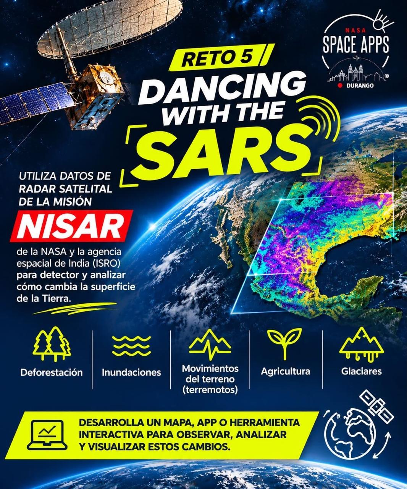

# 🚀 Nombre del Proyecto
*Proyecto creado para el NASA Space Apps Challenge 2026 - Reto: *

##### 📖 ¿Qué es?
Una breve descripción de 2-3 líneas sobre qué problema resuelve su aplicación y cómo ayuda a la misión. 

#### 🛠️ Tecnologías Utilizadas
* **Frontend:** React, Vite, Tailwind CSS
* **Backend:** Node.js, Express
* **Inteligencia Artificial:** OpenAI API / Modelos RAG

## ⚙️ Cómo correr el proyecto localmente
Instrucciones a prueba de tontos para que los jueces puedan probar su código:
1. Clona el repositorio: `git clone <URL>`
2. Instala las dependencias: `npm install`
3. Agrega tu clave en un archivo `.env`
4. Corre el servidor: `npm run dev`

## 👥 Equipo
* **Jose Jose** - Lead Developer & AI Integration
* **[Nombre]** - Frontend Developer

